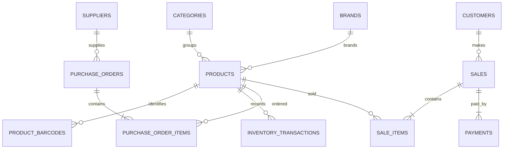

# Sari-Sari Store Sales and Inventory System

Spring Boot REST API, Supabase Postgres database, responsive browser dashboard/POS, and a native Android POS client. Supabase Auth issues the access tokens accepted by the API; the database service credentials remain server-side.

## Features

- Product, category, brand, customer, supplier, and purchase-order management
- Manual barcode entry, barcode/SKU lookup, and product-name search
- Transactional POS checkout: server-side prices, stock locking/decrement, sale items, payment, inventory history, and receipt number
- Dashboard sales count card and a filterable sales page with customer and purchased item details
- Inventory stock adjustments and purchase receiving with transaction history
- Admin/inventory-manager selling-price adjustments with reasons and a product activity timeline
- Dashboard sales and stock metrics, low/out-of-stock alerts, sales and gross-profit reports
- Role-protected endpoints for `ADMIN`, `CASHIER`, and `INVENTORY_MANAGER`
- Android sign-in through Supabase Auth, POS cart, checkout, token refresh, and Android system receipt printing

## Backend setup

Requirements: Java 17+, Maven 3.6.3+, and a Supabase project.

The root `.env` is loaded automatically and is excluded from Git. The database URL, username, and password must match Supabase Database → Connect; the URL must use SSL. Direct connections may require an IPv6-capable network, so use the Supabase session pooler URL if needed.

```powershell
$env:SUPABASE_DB_URL = "jdbc:postgresql://aws-0-ap-southeast-2.pooler.supabase.com:5432/postgres?sslmode=require"
$env:SUPABASE_DB_USERNAME = "postgres.xqqovgnuoebtjmnnclnd"
$env:SUPABASE_AUTH_ISSUER = "https://xqqovgnuoebtjmnnclnd.supabase.co/auth/v1"
$env:SUPABASE_JWKS_URI = "https://xqqovgnuoebtjmnnclnd.supabase.co/auth/v1/.well-known/jwks.json"
$env:SUPABASE_URL = "https://xqqovgnuoebtjmnnclnd.supabase.co"
$env:SUPABASE_ANON_KEY = "<publishable-or-anon-key>"
mvn spring-boot:run
```

The app listens on port `8094` by default. Override it with `$env:PORT` if needed.

This project uses Supabase's ES256 JWT signing key and validates access tokens against its JWKS endpoint. Keep the Supabase signing key asymmetric and ES256. Flyway applies `src/main/resources/db/migration` on startup. The schema uses PostgreSQL, not the MySQL engine in the original prompt, as requested.

Assign each role in `public.app_users` using the matching Supabase Auth user ID in `auth_user_id`. The API reads the role from active `app_users` rows for that Auth user ID; JWT metadata is not used for application roles. Never put a Supabase service-role key in the Android app or commit it to source control.

To insert the initial ADMIN, INVENTORY_MANAGER, and CASHIER records into `app_users`, run `scripts/add-app-user.sql` in Supabase Dashboard → SQL Editor. The matching accounts must already exist in Supabase Auth.

## Webpage

The browser app is in `src/main/resources/static/index.html` and is served by Spring Boot at `http://localhost:8094/`. Enter only your Supabase Auth username (email) and password on its sign-in page. The project URL and publishable/anon key are configured server-side through `SUPABASE_URL` and `SUPABASE_ANON_KEY`; never use a service-role key. The webpage includes the dashboard, stock alerts, barcode/product search, POS checkout with an on-screen receipt and user-triggered printing, product creation, selling-price changes, product history, and stock adjustments. Standard browsers show their print dialog; silent printing requires a managed kiosk/browser configuration such as Chrome's `--kiosk-printing` flag.

## Data model



`cashier_id`, `performed_by`, and `actor_id` store Supabase Auth UUIDs; they intentionally are not database foreign keys to the local profile table.

## Android app

Open `android-app` in Android Studio (Android Gradle Plugin 8.7.3, compile SDK 35). Create an untracked `android-app/local.properties`:

```properties
supabaseUrl=https://<project-ref>.supabase.co
supabaseAnonKey=<Supabase-publishable-or-anon-key>
apiBaseUrl=https://<your-api-host>
```

The Supabase publishable/anon key is intended for client use; database passwords and service-role keys are not. Deploy the API over HTTPS before using the app on a device.

## REST API

All `/api/**` endpoints require a Supabase bearer token. Role-restricted endpoints require an active role in `app_users` matching the token's Supabase Auth user ID.

| Method | Path | Access |
|---|---|---|
| GET | `/api/auth/me` | Any authenticated user |
| GET | `/api/products`, `/api/products/{id}` | Any authenticated user |
| GET | `/api/products/{id}/history` | Admin or inventory manager |
| PATCH | `/api/products/{id}/selling-price` | Admin or inventory manager |
| POST | `/api/products` | Admin or inventory manager |
| PUT | `/api/products/{id}` | Admin or inventory manager |
| GET | `/api/products/barcode/{barcode}` | Any authenticated user |
| POST | `/api/products/{id}/barcodes` | Admin/inventory manager |
| GET, POST | `/api/categories`, `/api/brands` | Read: authenticated; write: admin/inventory manager |
| GET, POST, PUT | `/api/customers` | Admin/cashier |
| GET, POST | `/api/suppliers` | Admin/inventory manager |
| GET, POST | `/api/purchase-orders` | Admin/inventory manager |
| POST | `/api/purchase-orders/{id}/order`, `/api/purchase-orders/{id}/receive` | Admin/inventory manager |
| POST | `/api/inventory/{productId}/adjustments` | Admin/inventory manager |
| GET | `/api/inventory/{productId}/transactions`, `/api/inventory/alerts` | Inventory manager/admin; alerts also cashier |
| POST | `/api/sales/checkout` | Admin/cashier |
| GET | `/api/dashboard` | Any store role |
| GET | `/api/dashboard/profit` | Admin |
| GET | `/api/sales/history` | Admin/cashier; paginated completed sales, optional `from`/`to` range, and period summary including gross profit |
| GET | `/api/reports/sales`, `/api/reports/best-sellers` | Admin/cashier or admin/inventory manager, respectively |
| GET | `/api/reports/products` | Admin/inventory manager; product sales, gross profit, stock health, and inventory value for a required `from`/`to` range; paginated with `limit`/`offset` |
| GET | `/api/reports/profit` | Admin |

Checkout accepts a cart of product IDs and quantities and an optional customer ID; the server calculates prices from the database and rejects insufficient stock. Admins and cashiers can open the dashboard Sales card to filter completed sales by date, month, or year and view the count, sales total, average sale, gross profit (sales line totals minus the cost saved at checkout), and purchased items. Gross profit does not include operating expenses. Sales without an associated customer appear as walk-ins. `amountTenderedInCents` is a whole number in minor currency units (e.g. `10000` means 100.00). Non-cash payment methods are recorded by the API but are not connected to a payment processor.

Admins and inventory managers can open Product reports to review product sales revenue, units sold, gross profit, current stock levels, low/out-of-stock counts, and inventory value. Product sales metrics use the selected date range; stock and inventory metrics reflect current inventory.

Product activity history includes product creation, stock transactions, and selling-price changes with the actor, timestamp, and reason where available. Existing stock transactions and product creation dates are retained; products created before activity tracking was enabled have no recorded creator, and earlier price changes cannot be reconstructed.

## Verification

```powershell
mvn verify
```

The Android client requires Android Studio and an installed Android SDK to build and run. Offline checkout/sync, backup/restore, dark mode, loyalty point rules, and camera barcode scanning are not included yet; these need additional product and operational decisions.
